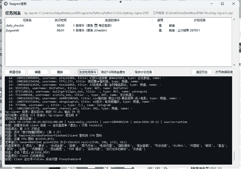
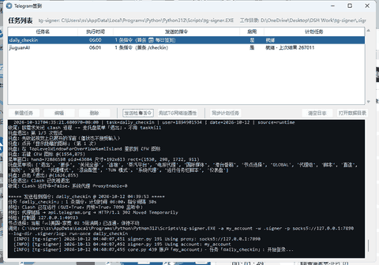
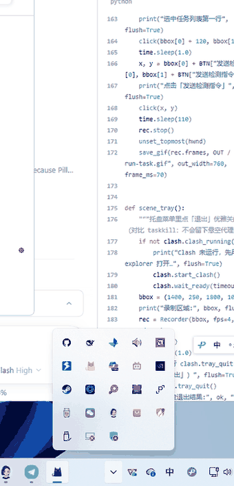

# Telegram签到

Windows 上的 Telegram 自动签到小工具：**图形界面管理任务（每个任务单独设执行时间）→ 自动预检/启动 Clash 并切换到可用节点 → 按序发送签到指令 → 走托盘菜单优雅关闭 Clash**。

它自己不做 Telegram 通信，而是编排成熟工具 [tg-signer](https://github.com/amchii/tg-signer)（BSD-3）来发消息，本仓库只负责"什么时候发、发之前网络要通、发之后把 Clash 收干净"。

## 演示

| ① 测试 TG 网络连通性 | ② 完整跑一次任务 | ③ 托盘优雅退出 Clash |
| --- | --- | --- |
|  |  |  |
| 只验证「代理 → 节点 → Telegram」，必要时临时拉起 Clash，测完恢复原状 | 点「发送检测指令」＝ 立刻完整跑一遍：预检 → 发指令（间隔 30s）→ 托盘退出 Clash | 右键托盘图标 → 点「退出」，不走 taskkill，系统代理不会被留成悬空状态 |

> 动图为实拍（鼠标指针是录屏时补画的），文件在 `docs/` 下；`run-once` 的登录阶段会打印账号最近对话，因此录制时已跳过该阶段。


---

## 功能

- **任务管理**：新建 / 编辑 / 删除任务；每个任务有自己的执行时间（`HH:MM`），落到各自的 Windows 计划任务（`tg-signer-<任务名>`）。
- **一个任务可含多条指令**：按顺序发送，支持设置相邻指令的间隔秒数（例如两条签到要求间隔 ≥30 秒）。
- **两个固定功能按钮**：
  - `发送检测指令`：把选中任务**立刻完整跑一遍**（等价于计划任务被触发），用于验证整条链路；
  - `测试TG网络连通性`：只测「本机代理 → 节点 → Telegram」，必要时临时拉起 Clash，**测完恢复原状**。
- **Clash 全自动**：没开就打开（实测必须用 `explorer.exe` 启动，见下文"踩坑"）；网络不通就自动测速换节点；结束时**从托盘菜单点「退出」**优雅关闭——不是 `taskkill`，所以不会留下悬空的系统代理把整台机器搞断网。
- **证据可查**：每次运行写日志到 `<repo_root>\.signer\logs\checkin\<任务名>-<时间>.log`；签到记录在 `.signer\data.sqlite3`（机器人常会自动清理会话，聊天窗口不是可靠依据）。

## 运行环境

| 项 | 要求 |
| --- | --- |
| 系统 | Windows 10/11（依赖 UI Automation + 计划任务） |
| Python | 3.10+ |
| 代理 | Clash for Windows（默认混合端口 `127.0.0.1:7890`） |
| 依赖工具 | `tg-signer`（Telegram 侧）、`uiautomation`（定位托盘图标） |

## 安装

```powershell
# 1) Telegram 侧工具
python -m pip install -U "tg-signer[gui,speedup,yaml]"
tg-signer login          # 交互式登录一次，生成 my_account.session

# 2) 本工具
python -m pip install uiautomation
# 打包成 exe 才需要：
python -m pip install pyinstaller pillow
```

## 首次使用

程序需要知道 **tg-signer 的工作目录**（`my_account.session` 在哪、`.signer` 就放哪）。按以下顺序解析：

1. 环境变量 `TG_SIGNER_REPO`；
2. 配置文件 `telegram_checkin.config.json`（exe 同级 → 包目录 → 用户主目录）；
3. 自动探测：包目录的上一级 / 当前目录里，含 `.signer` 或 `my_account.session` 的那个；
4. 兜底：包目录的上一级。

最省事的做法：**把 `tg-signer login` 跑在本仓库根目录**，然后直接运行程序即可。也可以用环境变量固定：

```powershell
setx TG_SIGNER_REPO "D:\path\to\your\tg-signer-workdir"
```

## 使用

图形界面（双击 exe 或 `python telegram_checkin\cli.py`）：

- 列表：任务名 / 执行时间 / 发送的指令 / 启用 / 计划任务状态（含下次运行时间）
- 双击一行 = 编辑；`新建任务` 里可加多条"机器人 chat_id 或 @用户名 + 指令文本"
- 保存时会写出 tg-signer 的 `signs\<任务名>\config.json`，并创建/更新同名计划任务

命令行：

```powershell
python telegram_checkin\cli.py --list                  # 列出任务
python telegram_checkin\cli.py --task daily_checkin    # 跑一次任务（计划任务调用的就是这条）
python telegram_checkin\cli.py --all                   # 跑所有已启用任务
python telegram_checkin\cli.py --test-network          # 只测 TG 网络连通性
python telegram_checkin\cli.py --sync-schedules         # 按任务时间同步计划任务
python telegram_checkin\cli.py --gui                   # 打开图形界面
# 可选：--skip-clash 跳过 Clash 处理；--force-stop-clash 结束后无条件关 Clash
```

## 打包成桌面 exe

```powershell
.\build_exe.ps1
```

等价于：

```powershell
python -m PyInstaller --noconfirm --onefile --windowed --name "Telegram签到" `
  --icon telegram_checkin\telegram.ico --add-data "telegram_checkin\telegram.ico;." `
  --hidden-import uiautomation --hidden-import comtypes --hidden-import comtypes.client `
  --collect-submodules comtypes --distpath dist --workpath build telegram_checkin\cli.py
```

图标由 `telegram.svg` 生成（`python telegram_checkin\icon_build.py`，用 Edge 无头渲染 + Pillow 打多尺寸 ICO）。

> 打包后 `sched.entry()` 会让计划任务直接执行 `Telegram签到.exe --task <任务名>`，所以**换位置后要重新跑一次 `--sync-schedules`**。

## 数据与隐私

程序本身不联网，也不收集任何东西。以下文件**只存在本地**，仓库已把它们列入 `.gitignore`，请勿提交：

- `my_account.session` / `*.session_string` —— **等同账号密码**；
- `.signer\` —— 工作目录（签到记录 `data.sqlite3`、最近会话缓存 `users\`、日志）；
- `telegram_checkin.config.json` / `local.config.json` —— 本机路径配置。

## 踩坑记录（都是实测结论）

1. **Clash 的托盘菜单不是 Win32 菜单**：`#32768` 恒为 `None`；右键后出现的是 `class='Chrome_WidgetWin_1'`、约 `192x613`、紧贴托盘图标上方的 **Electron 自绘窗口**。所以识别菜单的判据是"右键后新出现的窄 `Chrome_WidgetWin_1`"，并校验菜单里含「系统代理」才点「退出」。
2. **Win11 托盘图标藏在溢出浮窗**（`TopLevelWindowForOverflowXamlIsland`）；而且"视觉上开着、但不是本进程刚点开"的浮窗**不接受输入**，每次要先收起再点开。图标元素的 `automationId` 是 `NotifyItemIcon`，名字形如 `" Clash for Windows"`（注意首空格，且不能简单用 `SubName="Clash"` —— 网络图标的提示文字里也可能含 `Clash`）。
3. **直接启动 CFW 会静默自杀**：`os.startfile` / `subprocess.Popen` / PowerShell `Start-Process` 调用 CFW，都会在 5 秒内**以退出码 0、零输出**结束（`ELECTRON_ENABLE_LOGGING=1` 也没有任何输出）；把启动动作交给 **`explorer.exe`** 后，10 秒内 4 个 GUI 进程 + 内核 + 7890 全部就绪。现在 `start_clash()` 首选 explorer，其余方式仅兜底。
4. **`external-controller` 端口每次启动都变**（实测出现过 57331 / 55401 / 63425 / 55341 / 62988），只能从 `%USERPROFILE%\.config\clash\config.yaml` 读取 + 用 `netstat` 交叉验证，不能写死。
5. **强杀 Clash 会断网**：CFW 会把系统代理设成 `HKCU\...\Internet Settings\ProxyEnable=1` + `127.0.0.1:7890`，进程被强杀后这个悬空配置会让整台机器上不了网。所以收尾必须走托盘「退出」，并且仍保留 `fix_dangling_system_proxy()` 作为兜底。
6. **超时返回 `(None, "")` 是真值元组**：`find_controller()` 超时返回它，用 `if not ctl` 判空会失效并拿 `port=None` 空转；必须判 `ctl[0]`。
7. **`tg-signer` 的 `sign_interval` 是"相邻聊天之间的 sleep"**（`tg_signer/core.py` 的 `sign_once()`），所以多条指令的间隔用它；而 `run-once` 因为 `force_rerun=True` 会**忽略 `sign_at`**——调度完全由 Windows 计划任务负责。
8. **Windows PowerShell 5.1 的编码坑**：`Get-Content` 要 `-Encoding UTF8`，`Invoke-RestMethod` 解析 UTF-8 JSON 会乱码（改用 Python 或显式 `[Text.Encoding]::UTF8`）；打包成 `--windowed` 的 exe 后 `sys.stdout` 可能是 GBK，打印 emoji 会 `UnicodeEncodeError`，所以 `cli.py` 开头统一 `reconfigure(encoding="utf-8", errors="replace")`。

## 目录结构

```
telegram-checkin/
├── telegram_checkin/
│   ├── clash.py          # Clash 管控：预检/启动/选节点/托盘退出/系统代理修复
│   ├── store.py          # 任务注册表（.signer\checkin_tasks）与 tg-signer 配置生成
│   ├── signer.py         # 调用 tg-signer CLI，抽取"处理完成"证据
│   ├── orchestrator.py   # 编排：预检 → 发指令 → 收尾
│   ├── task_sched.py     # Windows 计划任务创建/更新/删除（每个任务一个）
│   ├── cli.py            # 入口：无参数开图形界面，--task 供计划任务调用
│   ├── gui.py            # tkinter 界面
│   ├── icon_build.py     # telegram.svg → telegram.ico
│   ├── telegram.ico / telegram.svg / telegram_256.png
├── examples/task.example.json
├── build_exe.ps1
└── requirements.txt
```

## 已知限制

- 托盘退出需要**用户已登录且会话未锁屏**（UI Automation 要能点到托盘）；锁屏时收尾会退化成"结束进程 + 修复系统代理"。
- 依赖全局安装的 `tg-signer`（换机需重装并重新 `tg-signer login`）。
- 计划任务默认"仅在用户登录时运行"，且勾选了"错过时间则尽快补跑"。
- 默认 `close_clash_always=true`：**即使 Clash 本来就在运行，签到结束后也会被关闭**（按需求"完成两条签到指令后关闭 clash 进程"）。不想要这个行为，在任务编辑里取消勾选。

## 致谢与许可

- Telegram 发送能力来自 [amchii/tg-signer](https://github.com/amchii/tg-signer)（BSD-3-Clause）。
- 本仓库自身未附许可协议；如需开源请自行补一个 `LICENSE`。
